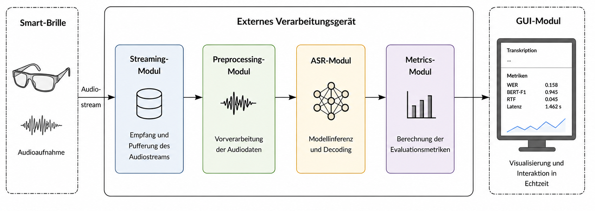

# ASR Demo

A live Automatic Speech Recognition (ASR) demonstrator for real-time audio streaming using Project Aria smart glasses.

The project supports multiple ASR backends, real-time transcription and automatic evaluation using transcription quality and latency metrics.


## Features

- Live audio streaming from **Project Aria Glasses**
- Streamlit-based user interface for controlling the demonstrator
- Support for multiple ASR models:
  - Zipformer (Kroko)
  - Vosk
  - Whisper + VAD
  - Qwen3-ASR + VAD

**Note:** The models listed above were used in the final evaluation of the demonstrator. Additional ASR models have also been integrated:
    
    
    - SimulStreaming
    - Parakeet

Additional features include:

- Real-time transcript visualization
- Ground-truth comparison with word-level highlighting
- Session logging and persistence
- Automatic computation of evaluation metrics:
  - Word Error Rate (WER)
  - Character Error Rate (CER)
  - Phoneme Error Rate (PER)
  - BERTScore (Precision, Recall, F1)
- Latency tracking:
  - Real-Time Factor (RTF)
  - Mean Inter-Output Delay

---

## Project Structure

```text
asr_demo/
├── app_fancy.py                   # Streamlit frontend for the demonstrator
├── streamlit_backend.py           # Backend process for live streaming and decoding
├── live_output.log                # Live backend log
├── latest_session.json            # Latest completed session payload
├── images                      # UI logo
├── sessions/
│   ├── hypotheses_sessions.csv    # Stored hypotheses per session
│   └── metrics.csv                # Computed evaluation metrics
├── core/
│   ├── streaming_controller.py    # Streaming module
│   ├── audio_preprocessing.py     # Audio preprocessing module
│   ├── base_observer.py
│   └── types.py
├── metrics/
│   └── metrics.py                 # Evaluation metrics implementation
└── models/                        # ASR model integration and inference
    ├── zipformer_model.py
    ├── vosk_model.py
    ├── whispervad_model.py
    ├── qwen3vad_model.py
    ├── simulstreaming_model.py
    └── ...

── analysis/
  ├── analyze.py                     # Generates evaluation plots and stores them in results/
  ├── denoise_analyze.py             # Compares model performance with and without noise reduction
  └── recording_stream_simulation/   # Streaming simulation experiment and comparison results
```

---

## How It Works

### Frontend (`app_fancy.py`)

The Streamlit application provides:

- model selection
- interface selection (`usb` or `wifi`)
- gain and noise-reduction configuration
- test metadata input (`test_id`, `person_id`, `gender`)
- start/stop control for the backend
- metric computation after a session ends

It also:

- reads the live log file
- reconstructs live partial and final transcriptions
- compares hypotheses against the ground truth
- displays the latest metrics from `sessions/metrics.csv`

### Backend (`streamlit_backend.py`)

The backend:

- reads runtime configuration from environment variables
- starts the Project Aria streaming controller
- loads the selected ASR model
- logs partial and final hypotheses
- tracks latency and output timing
- writes the final session payload to `latest_session.json`
- stores session hypotheses in CSV format

### Metrics (`metrics/metrics.py`)

The metrics module provides:

- text normalization
- WER and CER computation
- PER using `phonemizer`
- BERTScore using `bert-score`
- latency and inter-output statistics
- CSV export for later analysis

---

## Requirements

### System Requirements

This project is designed for Linux and depends on:

- Python 3.10+
- Project Aria SDK / `projectaria_tools`
- Access to audio streaming from an Aria device
- ASR model files stored locally under:
  - `ASR_models/...`
- Sherpa-ONNX
- `espeak-ng` for PER computation via `phonemizer`
- A PyTorch-compatible environment for transformer-based models and BERTScore

---

## Installation

### 1. Clone the repository

```bash
git clone <your-repo-url>
cd <your-repo>
```

### 2. Create a virtual environment

```bash
python3 -m venv .venv
source .venv/bin/activate
```

### 3. Install Python dependencies

```bash
pip install --upgrade pip
pip install -r requirements.txt
```

### 4. Install the Project Aria SDK

The demonstrator requires the Meta Project Aria SDK and Python bindings.

Official documentation:

https://facebookresearch.github.io/projectaria_tools/docs/ARK/sdk/setup

Follow the installation instructions provided in the official documentation.

### 5. Install Sherpa-ONNX

The project relies on Sherpa-ONNX for several streaming ASR models.

```bash
pip install sherpa-onnx
```

If this does not work, refer to:

Official installation guide:

https://k2-fsa.github.io/sherpa/onnx/

GitHub repository:

https://github.com/k2-fsa/sherpa-onnx

### 6. Ensure local ASR models are available

The project expects model directories such as:

```text
ASR_models/Zipformer/de/kroko_64l
ASR_models/vosk-model-small-de-0.15
ASR_models/sherpa-onnx-qwen3-asr-0.6B-int8-2026-03-25
ASR_models/sherpa-onnx-whisper-small
ASR_models/SimulStreaming
ASR_models/silero-vad.onnx
```

### 7. Downloading Models

If you want to install the models yourself, please refer to these repositories:


If you want to download the models yourself, refer to:

- **Qwen3-ASR**
  https://k2-fsa.github.io/sherpa/onnx/qwen3-asr/index.html

- **Whisper**
  https://k2-fsa.github.io/sherpa/onnx/pretrained_models/whisper/export-onnx.html

- **Kroko Zipformer**
  https://huggingface.co/hudaiapa88/sherpa-stt-onnx

- **Vosk**
  https://alphacephei.com/vosk/models

- **Additional Sherpa-ONNX Models**
  https://k2-fsa.github.io/sherpa/onnx/pretrained_models/index.html

**Note:** Update the hardcoded model paths in `app_fancy.py` and `streamlit_backend.py` if your setup differs.


---

## Running the App

Start the Streamlit frontend:

```bash
streamlit run app_fancy.py
```

Then in the UI:

1. Choose a model.
2. Choose the interface (`usb` or `wifi`).
3. Configure gain and noise reduction.
4. Enter optional metadata.
5. Click **Start**.
6. Speak or stream audio.
7. Click **Stop**.
8. Click **Compute Metrics**.

---

## Output Files

### `live_output.log`

Contains runtime events such as:

- `[INFO]`
- `[PARTIAL]`
- `[FINAL]`
- `[LIVE_HYP]`
- `[ERROR]`

### `latest_session.json`

Stores the most recent completed session, including:

- session metadata
- hypothesis text
- ground-truth text
- latency metrics
- output timing metrics

### `sessions/hypotheses_sessions.csv`

Stores one row per completed session.

### `sessions/metrics.csv`

Stores evaluation metrics and latency measurements.

---


## Example Workflow

```bash
streamlit run app_fancy.py
```

Inside the application:

- select `qwen3vad`
- choose `usb`
- set gain to `8.0`
- enable or disable noise reduction
- click **Start**
- stop after speaking
- click **Compute Metrics**

The UI will display:

- live transcription
- ground-truth comparison
- WER / CER / PER / BERTScore
- latency metrics such as RTF and first-output delay

---

## Troubleshooting

### Backend does not start

Check that:

- `streamlit_backend.py` exists
- the selected model files exist
- all required imports under `core/`, `models/`, and `metrics/` are available

### No live transcription appears

Check that:

- the Aria stream is running
- the correct interface is selected
- `live_output.log` is being written
- the model path is valid

